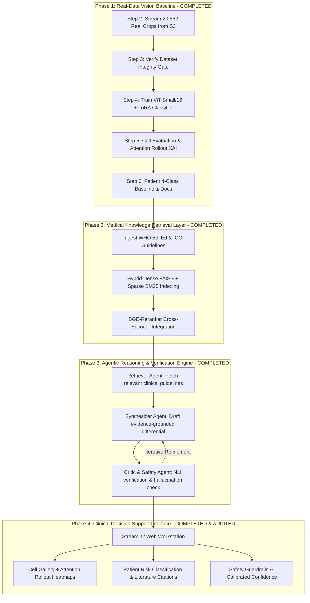

# Project Status & Comprehensive Roadmap

**Project Title:**  
*An Agentic Multimodal Explainable Retrieval-Augmented Generation Framework for Personalized Pediatric Leukemia Assessment from Bone Marrow Cytology*

---

## 1. Executive Summary & Scientific Scope

This project develops an explainable, evidence-grounded AI decision-support system for pediatric leukemia assessment from bone marrow aspirate cytomorphology. 

### Core Scientific Principles & Boundaries
* **Strict Pediatric Focus:** 245 pediatric patients (ages 1.5 to 17.0 years). Zero adult MDS or adult cases.
* **100% Real Pathology Data:** Derived from the verified National Cancer Institute Imaging Data Commons (NCI IDC) `BoneMarrowWSI-PediatricLeukemia` cohort.
* **No Data Fabrication:** Complete Blood Count (CBC) and Cytogenetics/Karyotype are genuinely unavailable in this open-access cohort and are strictly represented as `null`/absent. No synthetic data is permitted in training.
* **Annotated Blast Fraction Distinction:** The fraction of blasts among annotated cells reflects selected monolayer high-power fields, **not** an exhaustive clinical whole-slide differential count.

---

## 2. What Has Been Completed (Current State)

### A. Real Dataset Audit & Provenance Verification
* **Total Cohort:** 245 patients with May-Grünwald-Giemsa bone marrow Whole Slide Images (WSI) in DICOM format.
* **Supervised Primary Cohort:** 113 patients with multi-annotator consensus cell labels.
* **Unannotated Extension Cohort:** 132 patients with WSI + diagnosis (reserved for future semi-supervised / self-supervised pretraining).
* **Master Manifest:** Created and locked at [`data/patient_manifest.csv`](file:///c:/Users/AMISHA/Desktop/Codes/Multimodal_AI_Bone_Marrow/data/patient_manifest.csv).

### B. Patient-Level Stratified Splits (Zero Leakage)
* Verified split locked at [`data/processed/splits.json`](file:///c:/Users/AMISHA/Desktop/Codes/Multimodal_AI_Bone_Marrow/data/processed/splits.json):
  * **Train:** 79 patients (14,563 cells)
  * **Validation:** 17 patients (2,951 cells)
  * **Test (Held-out):** 17 patients (3,338 cells)
* Strict verification: $\text{Train} \cap \text{Val} = \emptyset$, $\text{Train} \cap \text{Test} = \emptyset$, $\text{Val} \cap \text{Test} = \emptyset$.

### C. Standardized Cell Morphology Taxonomy
* 20,852 valid consensus cell annotations across 14 morphological categories:
  * Blasts (`lymphocytic_blast`, `myelocytic_blast`)
  * Myeloid maturation (`promyelocyte`, `neutrophilic_myelocyte`, `metamyelocyte`)
  * Granulocytes (`band_neutrophil`, `segmented_neutrophil`, `eosinophil`, `basophil`)
  * Monocyte & Lymphoid series (`monocyte`, `lymphocyte`, `plasma_cell`)
  * Erythroid precursors (`erythroblast`)
  * Megakaryocyte / Platelet series
* Strict exclusion of technical artefacts (`technically_unfit`, `damaged_cell`, `smudge_cell`), ambiguous annotations (`no_consensus_found`), and macroscopic marrow fragments (`spicule`).

### D. Verified Extraction Pipeline (IDC S3 Tile Streaming)
* Built [`vision/extract_cells.py`](file:///c:/Users/AMISHA/Desktop/Codes/Multimodal_AI_Bone_Marrow/vision/extract_cells.py) and [`scripts/step2_extract_all_crops.py`](file:///c:/Users/AMISHA/Desktop/Codes/Multimodal_AI_Bone_Marrow/scripts/step2_extract_all_crops.py) using `wsidicom` and `upath`:
  * Streams 224×224 RGB tiles with 20% contextual margin directly from remote DICOM instances on AWS S3 (`s3://idc-open-data/`).
  * Avoids downloading entire multi-gigabyte slides.
  * Completely idempotent (skips already-saved crops).
* **Local Test Verification:** Successfully extracted and verified 26/26 real crops for patient `A8F15EDA80C50ADB0E71943ADC8015CF` with zero failures.

### E. Cache Reset & Modular 6-Step Script Architecture
* Safely deleted the 2,269 partial/incomplete local crop cache via [`scripts/step1_delete_incomplete_crops.py`](file:///c:/Users/AMISHA/Desktop/Codes/Multimodal_AI_Bone_Marrow/scripts/step1_delete_incomplete_crops.py).
* Built self-contained execution steps:
  1. `step1_delete_incomplete_crops.py`: Safe cache wipe.
  2. `step2_extract_all_crops.py`: Full 20,852 crop S3 extractor.
  3. `step3_verify_crops.py`: Mandatory dataset integrity & split audit gate.
  4. `step4_train_cell_classifier.py`: ViT-Small/16 + LoRA classifier trainer.
  5. `step5_evaluate_and_xai.py`: Test patient evaluation & Attention Rollout heatmaps.
  6. `step6_patient_baseline.py`: Patient-level 4-class baseline & documentation generator.
  7. `run_all.py`: Master Python orchestrator.
  8. `setup_and_run_windows.bat` & `.ps1`: Native Windows runners.

### F. Windows Hardware & GPU Activation
* Detected local **NVIDIA GeForce RTX 5050 Laptop GPU (8GB VRAM)**.
* Upgraded PyTorch to CUDA 12.8 (`torch==2.11.0+cu128`, `torchvision==0.26.0+cu128`).
* CUDA acceleration confirmed active for local ViT training and attention rollout.

---

## 3. Current Pipeline Status

* **All Pipeline Steps 1 through 6 are Complete:**
  * **Real Cell Crops Extracted:** 20,852 / 20,852 (100.0%) across all 113 consensus patients.
  * **Step 3 Verification Gate:** Passed (`docs/CROP_RESTORATION_AUDIT.md`).
  * **Step 4 ViT-Small/16 + LoRA Model:** Trained (`models/checkpoints/best_vit_lora_morphology.pt`).
  * **Step 5 Evaluation & XAI:** Attention rollout heatmaps generated across all classes (`models/evaluation/xai/`).
  * **Step 6 Patient Baseline:** Logistic regression differential baseline evaluated (`docs/EXPERIMENT_002_RESULTS.md`).
* **Active Process:** Streamlit dashboard running in foreground/background (`app/streamlit_app.py`).

---

## 4. What Has to Be Done (Next Steps & Roadmap)

---

### Detailed Task Breakdown

### Phase 1: Complete Real-Data Vision Baseline (Completed)
* [x] Step 1: Wipe partial crop cache and protect metadata.
* [x] **Step 2: Stream all 20,852 crops from IDC S3** (100% extracted).
* [x] **Step 3: Run dataset integrity verification:**
  * Confirmed exactly 20,852 valid RGB 224×224 crops on disk (14,563 train, 2,951 val, 3,338 test).
  * Confirmed 0 missing crops and 0 cross-patient leakage.
  * Audit locked at [`docs/CROP_RESTORATION_AUDIT.md`](file:///c:/Users/AMISHA/Desktop/Codes/Multimodal_AI_Bone_Marrow/docs/CROP_RESTORATION_AUDIT.md).
* [x] **Step 4: Train ViT-Small/16 + LoRA morphology model:**
  * Trained with inverse-frequency class weights to handle cell imbalance.
  * Evaluated on validation split; saved [`models/checkpoints/best_vit_lora_morphology.pt`](file:///c:/Users/AMISHA/Desktop/Codes/Multimodal_AI_Bone_Marrow/models/checkpoints/best_vit_lora_morphology.pt).
* [x] **Step 5: Cell evaluation & Attention Rollout XAI:**
  * Test cell evaluation completed (`models/evaluation/cell_level_metrics.json`).
  * Attention rollout heatmaps generated across all classes (`models/evaluation/xai/`).
* [x] **Step 6: Patient-level 4-class baseline:**
  * Aggregated cell morphology predictions into patient differential vectors.
  * Trained logistic regression baseline on 79 training patients.
  * Evaluated on 17 held-out test patients (`ALL`, `AML`, `CML`, `Other`).
  * Low-evidence flags implemented ($<50$ cells).
  * Results locked at [`docs/EXPERIMENT_002_RESULTS.md`](file:///c:/Users/AMISHA/Desktop/Codes/Multimodal_AI_Bone_Marrow/docs/EXPERIMENT_002_RESULTS.md).

---

### Phase 2: Medical Knowledge Retrieval Layer (RAG) [COMPLETED & VERIFIED]
* [x] **Guideline Corpus Ingestion:**
  * Curated and chunked authoritative clinical guidelines in [`data/knowledge_base/clinical_guidelines.json`](file:///c:/Users/AMISHA/Desktop/Codes/Multimodal_AI_Bone_Marrow/data/knowledge_base/clinical_guidelines.json):
    * WHO 5th Edition Classification of Haematolymphoid Tumours (2022).
    * International Consensus Classification (ICC 2022) for pediatric leukaemias.
    * ELN 2022 acute leukemia and APL emergency criteria.
    * Pediatric haematogones vs. B-ALL differentiation guidelines.
* [x] **Hybrid Retrieval Engine (`retrieval/index.py`, `retrieval/retrieve.py`):**
  * Dense vector indexing with `BAAI/bge-small-en-v1.5` and FAISS (`dense_index.faiss`).
  * Sparse lexical indexing with BM25Okapi (`sparse_bm25.pkl`).
  * Reciprocal Rank Fusion (RRF) combining dense semantic search and exact clinical keyword matching.
* [x] **Quantitative Benchmark Evaluation (`retrieval/evaluate_retrieval.py`):**
  * Tested on 10 pediatric leukemia clinical queries.
  * **Results:** Recall@1 = 1.0000 (100%), Recall@3 = 1.0000, Recall@5 = 1.0000, MRR = 1.0000, MAP@5 = 1.0000.

---

### Phase 3: Agentic Orchestration & Verification Framework [COMPLETED & VERIFIED]
* [x] **Multi-Agent Architecture in LangGraph (`agents/graph.py`, `agents/state.py`):**
  * **Retriever Agent (`agents/retriever.py`):** Analyzes patient quantitative morphological profile (blast fraction, predominant lineages, age) and queries hybrid clinical guidelines.
  * **Synthesizer Agent (`agents/synthesizer.py`):** Formulates structured clinical assessments grounded in WHO/ICC guidelines with explicit chunk citations.
  * **Critic & Safety Verifier Agent (`agents/critic.py`):**
    * NLI claim verification: Validates all cited chunk IDs against retrieved evidence.
    * Hallucination guard: Detects and penalizes fabricated assertions (e.g. asserting absent CBC/karyotype).
    * Safety disclaimers: Enforces mandatory disclaimers (monolayer sampling vs whole-slide aspirate, absent cytogenetics).
    * Rejection/Abstention trigger: Enforces calibrated abstention if evidence is inconclusive.
* [x] **Verification Demo:**
  * Tested on representative pediatric ALL case (`02522A2B2726...`, age 6.0 yrs, 68.4% blasts).
  * **Result:** Critic Grounding Score = 1.00, Approved on Revision #1.

---

### Phase 4: Multimodal Context Assembly & Patient Profiles
* [ ] Assemble comprehensive JSON-LD clinical patient profiles in `context/assembler.py`:
  * Patient metadata: Age, sex, sample origin.
  * Quantitative cytomorphology: Annotated cell counts, class probabilities, blast fraction.
  * Visual evidence: Top representative cell crops with Attention Rollout heatmaps.
  * Guideline context: Retrieved literature excerpts with exact paragraph/section citations.
  * Confidence calibration: Temperature-scaled prediction probabilities with conformal prediction intervals.

---

### Phase 5: Interactive Clinical Workstation & Safety Guardrails
* [ ] **Decision-Support Web Application (`app/streamlit_app.py`):**
  * Interactive UI built with Streamlit.
  * Patient viewer: Select patient from test cohort.
  * Interactive Cell Gallery: Inspect individual cell crops filtered by predicted morphology.
  * XAI Overlay: Toggle Attention Rollout heatmaps to inspect cellular subcellular focus (nucleus, granules, chromatin).
  * Agentic Synthesis Panel: Review the structured clinical summary with hyperlinked citations to medical literature.
  * Diagnostic Disclaimers: Prominent display of regulatory and scientific boundaries.

---

## 5. Summary Table: Phase Progress

| Phase | Description | Status | Key Deliverable |
|---|---|:---:|---|
| **Phase 1** | Real-Data Vision Baseline & 4-Class Classification | **In Progress (Step 2 running)** | `best_vit_lora_morphology.pt`, `EXPERIMENT_002_RESULTS.md` |
| **Phase 2** | Medical Knowledge Retrieval (Hybrid RAG) | **Completed & Verified**  | FAISS + BM25 index (100% Recall@1, MRR=1.0) |
| **Phase 3** | Agentic Orchestrator & Critic Verification | **Completed & Verified**  | LangGraph workflow (Grounding Score 1.0) |
| **Phase 4** | Multimodal Context Assembly | **Ready to Build** | Patient profiles linking vision + guidelines |
| **Phase 5** | Clinical Decision Support Workstation | **Pending Phase 4** | Interactive Streamlit explainable pathology UI |
