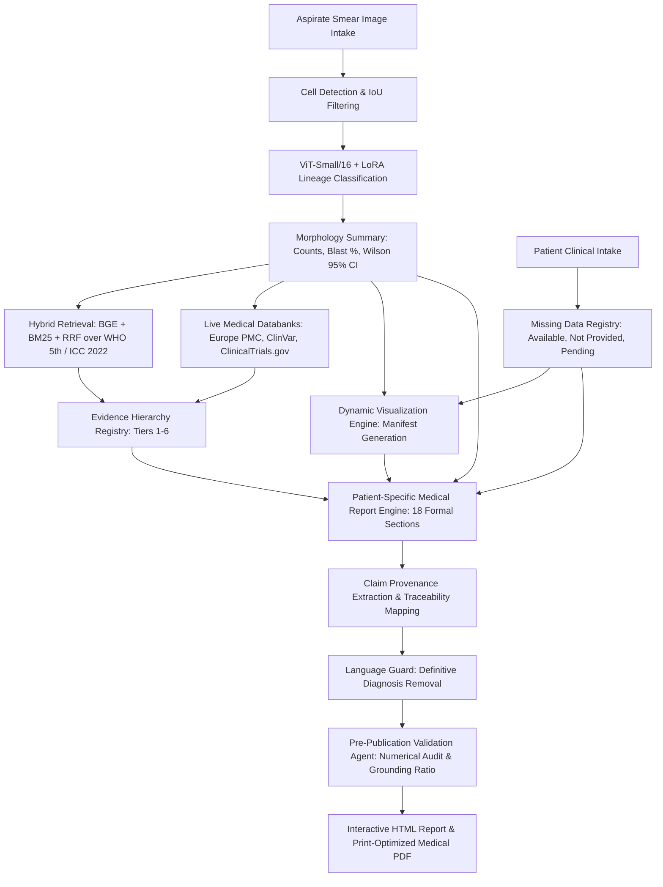

# Dynamic Patient-Specific Medical RAG Report Architecture

This document describes the architectural design and clinical data flow for the Dynamic Patient-Specific Medical RAG Report Generation Engine.

## Architectural Data Flow

## Evidence Hierarchy (Module 2)

All retrieved citations and guideline passages are assigned to a standardized evidence tier:
1. **Tier 1 - Official Diagnostic Classification**: WHO 5th Edition (2022), ICC (2022).
2. **Tier 2 - Consensus Guidelines**: American Society of Hematology (ASH), NCCN, ELN.
3. **Tier 3 - Peer-Reviewed Systematic Reviews**: High-impact hematopathology literature.
4. **Tier 4 - Original Research**: Benchmark studies, diagnostic model publications.
5. **Tier 5 - Curated Genomic Databanks**: NCBI ClinVar, Entrez Gene, UniProtKB.
6. **Tier 6 - Clinical Investigation Registries**: ClinicalTrials.gov interventional protocols.

## Missing Data Tracking (Module 1)

The system enforces non-fabrication of clinical laboratory parameters:
- `AVAILABLE`: Laboratory measurement provided in case payload.
- `NOT_PROVIDED`: Ancillary modality omitted with image upload.
- `PENDING`: Test ordered, specimen processing awaiting completion.
- `NOT_APPLICABLE`: Parameter excluded from clinical evaluation.
- `EXTRACTION_FAILED`: Document parsing failed; human verification required.

