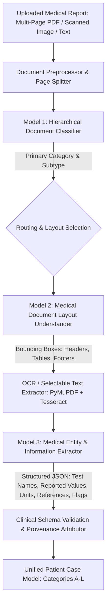

# Training Strategy & Model Architecture: Medical Document AI

This document establishes the proposed 3-tier model training architecture and validation methodology for the Medical Document AI Subsystem.

---

## 1. Three-Tier Model Architecture

### Model 1: Hierarchical Document Classifier
- **Task**: Classifies document pages into the 14 Primary Categories (Level 1) and Subtypes (Level 2).
- **Recommended Base Architecture**: 
  - Vision-Language approach: **LayoutLMv3-Small / DiT (Document Image Transformer)** or a lightweight text+visual backbone (**BioLinkBERT / DistilBERT** fused with visual page layout embeddings).
  - Handles single-page, multi-page, and mixed-report PDFs with an abstention mechanism (`UNKNOWN_CATEGORY`) when confidence $< 0.70$.
- **Input**: Page image (resized $224\times 224$ or $512\times 512$) + extracted token stream.
- **Output**: Category probabilities, predicted subtype, page type label.

### Model 2: Document Layout Understander
- **Task**: Segment document components into bounding boxes: `Document Title`, `Section Header`, `Laboratory Metadata`, `Results Table`, `Table Headers`, `Data Rows`, `Footnote / Notes`.
- **Recommended Base Architecture**: **YOLOv10 / Faster R-CNN fine-tuned on DocLayNet & PubLayNet**, adapted for laboratory tables and pathology consult grids.
- **Benefit**: Accurately isolates dense multi-column laboratory tables (e.g. CBC panels and flow marker grids) to eliminate reading-order confusion.

### Model 3: Medical Information Extractor
- **Task**: Extract structured key-value entities, clinical assertions, units, reference intervals, and abnormality flags.
- **Recommended Base Architecture**: **Donut (Document Understanding Transformer)** or **LayoutLMv3 Token Classification (BIO Tagging)** with schema validation via Pydantic.
- **Key Capabilities**:
  - CBC: Extract `Hemoglobin`, `WBC`, `Platelets`, `ANC`, units (`g/dL`, `x10^9/L`), and flags (`Low`, `High`).
  - Cytogenetics: Extract ISCN strings (`46,XX,del(5)(q31q33)`), clone counts, and abnormality flags without truncation.
  - Molecular: Extract gene names (`TP53`, `NPM1`, `FLT3`), variant descriptions, and VAF percentages.
  - Flow Cytometry: Gated population blast %, CD marker positive/negative status.

---

## 2. Training Data Strategy & Data Preparation Plan

To train and evaluate these models without risking HIPAA violations or dataset leakage:

1. **Pretraining & Transfer Learning**:
   - Leverage weights pretrained on `DocLayNet` (80k pages) and `PubLayNet` (360k pages) for generalized document layout features.
   - Utilize biomedical language models (`PubMedBERT`, `BioLinkBERT`) for token-level embeddings.
2. **Specialized Hematology Dataset Construction (Phase 8)**:
   - Synthesize a diverse, de-identified corpus of 1,200+ multi-page hematology reports spanning all 12 clinical categories (Categories A–L).
   - Use clinically authentic parameter ranges derived from WHO 5th Ed, ICC 2022, and NCBI GEO leukemia metadata.
   - Generate token-level ground truth JSON annotations with character bounding boxes, units, reference ranges, and flags.
3. **Group-Aware Splitting & Leakage Prevention**:
   - Split: **70% Training / 15% Validation / 15% Test**.
   - Grouping key: Reports generated from the same template layout or clinical scenario will never cross between training and test sets.
   - The test set includes an untouched partition of diverse hospital template formats (evaluating out-of-distribution robustness).

---

## 3. Evaluation & Validation Metrics (Phase 10)

| Subsystem | Target Metrics | Clinical Safety Gate |
| :--- | :--- | :--- |
| **Model 1: Classification** | Macro F1 $\ge 0.92$, Weighted F1 $\ge 0.95$, Per-category Precision & Recall | Abstention trigger on out-of-distribution documents ($< 0.70$ confidence) |
| **Model 2: Layout Understanding** | Table mAP@0.5 $\ge 0.90$, Section Header mAP $\ge 0.88$ | Zero row-column interleaving on tabular panels |
| **Model 3: Information Extraction** | Entity F1 $\ge 0.90$, Exact Value Match $\ge 0.96$, Unit Match $\ge 0.98$ | Critical values (Blast %, Hb, Platelets) audit before insertion into patient case |

---

## 4. Execution Roadmap

- **Stage 1 (Completed)**: Dataset Discovery, License Audit (`docs/MEDICAL_DOCUMENT_DATASET_CATALOG.md`), and Training Architecture Proposal (`docs/TRAINING_METHODOLOGY.md`).
- **Stage 2**: Pretrained Model Benchmarking & Pipeline Environment Setup (`document_ai/`).
- **Stage 3**: Synthetic & Open-Data Preparation, Annotation Manifests (`data/document_ai/`).
- **Stage 4**: Baseline Document Classifier Training (Model 1).
- **Stage 5**: Layout Understanding & Table Segmentation (Model 2).
- **Stage 6**: Medical Entity & Information Extraction (Model 3).
- **Stage 7**: Full Integration with Flask `/api/upload-document`, LangGraph agents, and the Dynamic RAG Report Engine.
