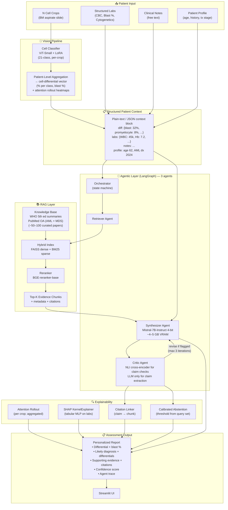
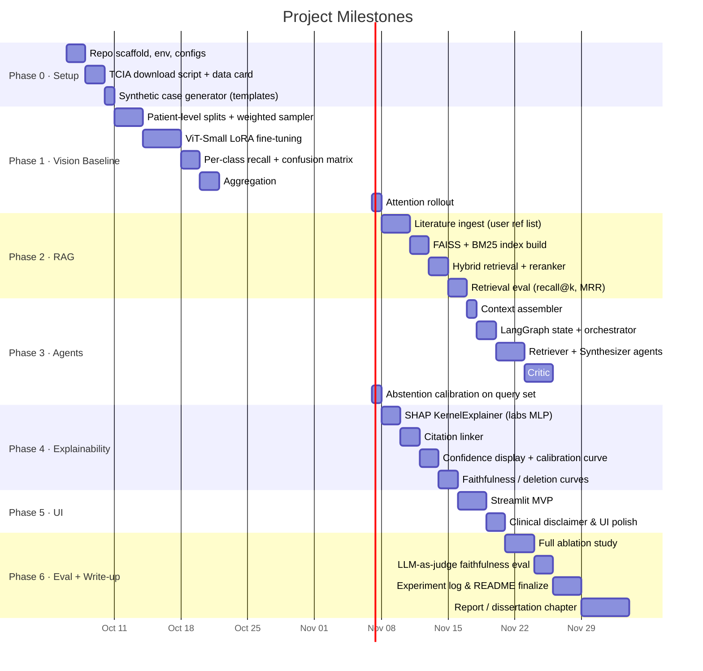

# Implementation Plan
## "An Agentic Multimodal Explainable RAG Framework for Personalized Bone Marrow Assessment"

> **⚠️ RESEARCH & DECISION-SUPPORT TOOL ONLY**  
> This system is a research prototype. It does **not** constitute medical advice or a clinical diagnosis. All outputs must be reviewed by a qualified haematologist.

---

## 0. Dataset Provenance — Verified

| Dataset | Modality | Classes | Cells | License | Decision |
|---|---|---|---|---|---|
| **Matek et al. 2021 — Bone Marrow Cytomorphology** (TCIA DOI: 10.7937/TCIA.AXH3-T579) | ✅ Bone marrow aspirate | 21 | ~171k | **CC BY 4.0** | ✅ **Primary vision dataset** |
| Matek et al. 2019 — Munich AML Morphology | ❌ Peripheral blood smear | 15 | ~18k | CC BY 4.0 | ❌ Dropped (wrong modality) |
| Acevedo et al. 2020 | ❌ Peripheral blood smear | 8 | ~17k | CC BY 4.0 | ❌ Dropped (wrong modality) |

**Download script:** `data/download_tcia.py` (included in Phase 0). TCIA requires registration and citation; no DUA. CC BY 4.0 allows public repo use with attribution.

**Classification standard:** **WHO Classification of Haematolymphoid Tumours, 5th edition (2022)** is the primary classification for the RAG knowledge base and diagnostic reasoning. ICC 2022 criteria are noted where they diverge, but WHO 5th is the single reference standard for label mappings and prompts.

---

## 1. Architecture Overview



---

## 2. Data Sources & Licenses

| Dataset / Source | Content | Modality | License | Use |
|---|---|---|---|---|
| **Matek et al. 2021 — Bone Marrow Cytomorphology** (TCIA) | 171,375 cells · 21 classes · 945 patients | ✅ Bone marrow aspirate | **CC BY 4.0** | ✅ Primary vision fine-tuning |
| **PubMed Central Open Access** (PMCOA) subset | Full-text articles (AML + MDS) | — | CC BY / CC BY-NC subsets only | RAG knowledge base |
| **OpenAlex** API | Paper metadata + abstracts | — | CC0 | RAG augmentation |
| **WHO Classification of Tumours 5th ed. summaries** | Structured disease criteria | — | Fair-use excerpts; cite source | RAG knowledge base (primary standard) |
| **Synthetic patient profiles** (rule-based templates) | CBC, cytogenetics, clinical notes, cell differentials | — | MIT (self-generated) | Synthesizer reasoning demos + evaluation; NOT used to train vision model |

> **Data integrity note:** Real TCIA images are used **only** for training the cell classifier. Synthetic patient cases (labs + notes + sampled crop sets) are used for end-to-end pipeline evaluation. There is **no joint training** across modalities — no paired real-image + synthetic-lab loss.

---

## 3. Model Choices & Justification

### 3.1 Vision Pipeline: Cell Classification + Patient-Level Aggregation

The vision output is a **cell-differential vector**, not a raw embedding fed into a learned fusion layer.

**Step 1 — Per-crop classification:**  
ViT-Small/16 + LoRA classifies each of the N cell crops from a slide into one of 21 bone marrow cell classes.

**Step 2 — Patient-level aggregation:**  
```
differential[class] = count(class) / N_total_crops   # fractional composition
blast_pct           = differential["myeloblast"] + differential["promyelocyte"]  # or per WHO 5th
```
This produces a human-interpretable cell-differential vector (e.g., `{blast: 32%, promyelocyte: 8%, neutrophil: 15%, ...}`) that is directly usable by clinicians and does not require a trained fusion decoder.

**Step 3 — Downstream use:**  
The differential vector (as structured text/JSON) is assembled into the Structured Patient Context block and passed to the Synthesizer. No learned cross-modal weights are involved.

#### Vision Encoder Options

| Option | Params | Justification | PEFT strategy |
|---|---|---|---|
| **ViT-Small/16 (ImageNet-21k)** ✅ | ~22 M | Well-studied, strong transfer, fits Colab T4 | LoRA (r=8, α=16) on attention layers |
| ConvNeXt-Tiny | ~28 M | Strong inductive bias for cell morphology | Fine-tune last 2 blocks |
| UNI / CONCH (pathology FMs) | ~300–400 M | SOTA on path tasks | A100 only; gated models |

**Decision:** ViT-Small + LoRA. Config flag to swap backbone.

#### Train / Val / Test Splits — Patient-Level

Splits are **patient-level** (no patient appears in more than one split) to prevent data leakage from the same slide being seen at train and test time.

```
Patient-level stratified split:
  Train  70%  → ~661 patients
  Val    15%  → ~142 patients
  Test   15%  → ~142 patients
```

**Class-imbalance handling:**
- Weighted random sampler (per-class inverse frequency) during training.
- Optional: online hard-example mining for rare classes (e.g., hairy cells, Gaucher cells).
- Label smoothing (ε = 0.1).

**Reporting:** Per-class recall and F1 reported alongside macro averages. Confusion matrix exported per split. Rare-class performance called out explicitly in experiment log.

### 3.2 Explainability for ViT: Attention Rollout (primary)

Plain Grad-CAM performs poorly on transformers (attention heads are not spatial feature maps).

- **Attention rollout** (Abnar & Zuidema 2020) as the **primary** method — roll attention matrices across all layers for a single spatial attribution map per crop.
- Rollouts aggregated at patient level (mean map across blast-class crops) for the report.
- Grad-CAM retained **only** if ConvNeXt backbone is used.
- DINO-style self-supervised attention maps as an optional visual sanity check.

### 3.3 Text / Note Encoder

| Option | Justification |
|---|---|
| **PubMedBERT-base** ✅ | Biomedical domain, 110 M params, MIT license |
| BioLinkBERT-base | Better on entity linking; swap-in if time allows |

**Decision:** PubMedBERT-base for dense retrieval embeddings only. Frozen; no note-encoder fine-tuning.

### 3.4 Tabular Labs & SHAP

A lightweight 3-layer MLP maps the structured lab panel (~20 features: CBC panel, blast %, cytogenetic flags) to a 128-d vector used **only** for SHAP attribution display — it is **not** fused into the LLM input via learned weights.

**SHAP method:** `shap.KernelExplainer` (model-agnostic). `DeepExplainer` is not model-agnostic and is avoided. `TreeExplainer` available if an XGBoost surrogate is used.

### 3.5 Structured Patient Context (replaces learned Fusion module)

The `fusion/` directory and all learned cross-modal weights are **removed**. Instead, a deterministic assembler formats a plain-text + JSON context block:

```
## Cell Differential (N=200 crops)
myeloblast: 32%  promyelocyte: 8%  neutrophil: 15%  ...

## Laboratory
WBC: 45×10⁹/L  Hb: 7.2 g/dL  Plt: 38×10⁹/L
Cytogenetics: t(8;21)(q22;q22.1), RUNX1::RUNX1T1

## Clinical Notes
62-year-old male. Fatigue, petechiae. AML diagnosed 2024-08.

## Patient Profile
Age: 62  Sex: M  Treatment stage: Induction cycle 1
```

This block is the sole multimodal input to the Synthesizer. No learned fusion weights. Gating weights and ablation code are removed.

### 3.6 Synthetic Patient Cases (Rule-Based Templates)

Synthetic cases are used for **pipeline evaluation**, not vision training. They are generated from WHO 5th / ICC 2022 diagnostic criteria for AML and MDS:

**Template structure per case:**
- `condition`: AML-M2, AML-M3, MDS-EB1, MDS-EB2, MDS-SLD, etc.
- `blast_pct`: sampled from condition-appropriate distribution (e.g., AML: 20–80%)
- `differential`: remaining classes sampled to sum to 100%
- `lab_panel`: CBC values consistent with condition (rule-based ranges)
- `cytogenetics`: condition-appropriate flags (t(8;21), inv(16), del(5q), etc.)
- `notes`: template-filled clinical narrative
- `ground_truth_who5`: WHO 5th diagnosis label (kept for evaluation)
- `crop_set`: N crops sampled from TCIA images whose labels match the differential

The crop-sampling step ensures that the cell images shown in a synthetic case are real TCIA cells of the right class — only the patient-level pairing is synthetic. Ground truth is preserved for evaluating the full pipeline.

### 3.7 RAG & Retrieval

| Component | Choice | Justification |
|---|---|---|
| Chunking | Recursive text splitter, chunk=512, overlap=64 | Preserves sentence context |
| Dense embeddings | `BAAI/bge-small-en-v1.5` (33 M) | Fast, high quality, MIT license |
| Vector store | **FAISS** (flat + IVF for scale) | CPU-friendly, no server needed |
| Sparse | BM25 via `rank_bm25` | Catches exact terminology (e.g., "del(17p)") |
| Reranker | `BAAI/bge-reranker-base` | Lightweight, strong cross-encoder reranking |
| Hybrid fusion | RRF (Reciprocal Rank Fusion) | Simple, no extra params |

**Knowledge base scope:** ~50–100 papers provided by user. Reasoning narrowed to **AML and MDS** under WHO 5th edition.

### 3.8 LLM (Synthesizer / Critic)

| Option | Size | VRAM (4-bit) | Access | Notes |
|---|---|---|---|---|
| **Mistral-7B-Instruct-v0.3** ✅ | 7 B | **~4–5 GB** | Apache 2.0 | Fits Colab T4 comfortably |
| Phi-3-mini-4k-instruct | 3.8 B | ~2–3 GB | MIT | Fallback if memory-constrained |

---

## 4. Agentic Design — 3 Agents

### Agent roles

| Agent | Role | Tools |
|---|---|---|
| **Retriever** | Hybrid RAG retrieval; reranks; returns top-K evidence chunks with citations | FAISS search, BM25, BGE-reranker |
| **Synthesizer** | Reads Structured Patient Context + evidence chunks; drafts structured clinical report | Mistral-7B 4-bit, prompt templates |
| **Critic** | Extracts claims from draft (LLM); verifies each claim against evidence (NLI cross-encoder); flags `[UNSUPPORTED]`; triggers revision or abstention | Claim extractor (LLM), NLI cross-encoder (e.g., `cross-encoder/nli-deberta-v3-small`), confidence scorer |

### Critic design detail

The **LLM is used only for claim extraction** (decomposing the draft into atomic factual claims). Claim verification is handled by a lightweight **NLI cross-encoder** (`cross-encoder/nli-deberta-v3-small`, ~180 MB):

```
for claim in extracted_claims:
    scores = nli_model(premise=evidence_chunk, hypothesis=claim)
    entailment_score = scores["entailment"]
    if entailment_score < ABSTENTION_THRESHOLD:
        flag claim as [UNSUPPORTED]
```

**Abstention threshold calibration:** The threshold is not hand-picked. It is calibrated on `eval/query_set.json` (hand-built QA pairs with known-supported and known-unsupported claims) by maximising F1 of correct abstention decisions. The calibrated threshold and calibration curve are logged.

### Abstention behaviour

If after 3 Critic–Synthesizer iterations ≥ 1 claim remains `[UNSUPPORTED]`, or if retrieval returns no chunks above the calibrated similarity threshold:

> "Insufficient evidence in the knowledge base to support a confident assessment for this case. Please consult a haematologist and refer to the current WHO Classification of Haematolymphoid Tumours (5th edition)."

---

## 5. Project Structure

```
bonemarrow/
├── README.md
├── requirements.txt
├── .env.example
├── configs/
│   ├── default.yaml          # model paths, hyperparams, seeds (seed=42)
│   └── colab.yaml            # memory-optimised overrides
├── data/
│   ├── download_tcia.py      # TCIA download script (Q5: included)
│   ├── raw/                  # downloaded TCIA images (gitignored)
│   ├── processed/            # patient-level splits (train/val/test, no overlap)
│   ├── synthetic/            # rule-based AML/MDS cases with ground truth
│   ├── knowledge_base/       # chunked WHO 5th + PubMed OA (gitignored if large)
│   └── dataset_cards/        # license & provenance docs
├── vision/
│   ├── dataset.py            # PyTorch Dataset; patient-level split loader
│   ├── model.py              # ViT-Small + LoRA wrapper
│   ├── train.py              # training loop; weighted sampler; W&B logging
│   ├── evaluate.py           # per-class recall, F1, macro avg, confusion matrix
│   ├── aggregate.py          # N crops → cell-differential vector + blast %
│   └── attention_rollout.py  # attention rollout (primary ViT explanation)
├── retrieval/
│   ├── ingest.py             # chunk + embed literature
│   ├── index.py              # FAISS + BM25 index build/load
│   ├── retrieve.py           # hybrid retrieval + reranker
│   └── evaluate_retrieval.py # recall@k, MRR, nDCG
├── context/
│   └── assembler.py          # differential + labs + notes + profile → context block
├── synthetic/
│   ├── templates.py          # rule-based AML/MDS case templates
│   ├── sampler.py            # sample crop sets matching each differential
│   └── generate.py           # batch generate cases; write JSON with ground truth
├── agents/
│   ├── state.py              # LangGraph state schema
│   ├── graph.py              # 3-agent orchestrator graph
│   ├── retriever.py          # Retriever agent
│   ├── synthesizer.py        # Synthesizer agent (Mistral-7B)
│   ├── critic.py             # Critic: LLM claim extraction + NLI verification
│   └── tools.py              # shared tool definitions
├── explain/
│   ├── shap_explainer.py     # KernelExplainer (model-agnostic; labs MLP)
│   ├── citation_linker.py
│   └── confidence.py         # calibrated abstention threshold
├── app/
│   ├── streamlit_app.py      # sole UI (no FastAPI, no React)
│   └── components/           # reusable Streamlit widgets
├── eval/
│   ├── vision_eval.py
│   ├── retrieval_eval.py
│   ├── rag_faithfulness.py   # LLM-as-judge
│   ├── ablation.py
│   ├── calibrate_threshold.py # calibrate abstention threshold on query set
│   └── query_set.json        # hand-built QA pairs (AML + MDS; WHO 5th labels)
├── tests/
│   ├── test_vision.py
│   ├── test_retrieval.py
│   ├── test_agents.py
│   └── test_explain.py
└── docs/
    ├── architecture.md
    ├── dataset_licenses.md
    ├── experiment_log.md
    └── clinical_disclaimer.md
```

---

## 6. Phased Milestone Timeline



**Estimated total:** ~10 weeks at part-time research pace.

---

## 7. Risks & Mitigations

| Risk | Likelihood | Impact | Mitigation |
|---|---|---|---|
| GPU OOM during ViT fine-tuning | High | High | LoRA + gradient checkpointing + bf16 mixed precision |
| Patient-level splits cause class imbalance in val/test | Medium | Medium | Stratify split on condition label, not just class counts |
| NLI cross-encoder entailment scores poorly calibrated | Medium | Medium | Calibrate threshold on query set; report calibration curve |
| Crop aggregation overestimates blast % (slide variation) | Medium | Medium | Report confidence interval on differential; flag low-N cases |
| Synthetic case differentials unrealistic | Medium | Medium | Validate template distributions against published BM differential ranges |
| RAG hallucination / unsupported claims | Medium | High | Critic NLI check + calibrated abstention |
| WHO text not openly licensed | Medium | Medium | Use open-access summaries only; never reproduce verbatim |
| Knowledge base too broad to evaluate | Medium | Medium | Narrow to AML + MDS; hand-curated user ref list |
| **⚠️ Clinical:** Model conflates morphologically similar cell classes | High | High | Per-class confidence; flag low-confidence crops; prominent disclaimer |

---

## 8. Key Design Decisions

1. **Patient-level cell-differential as vision output** — N crops classified → fractional differential vector. Human-interpretable; no learned fusion decoder needed.
2. **Patient-level train/val/test splits** — prevents data leakage from the same slide appearing in train and test.
3. **No learned fusion module** — differential + labs + notes assembled deterministically into a structured context block passed to the Synthesizer. Removes all circular evaluation risk.
4. **Synthetic cases from rule-based templates** — crops sampled from real TCIA cells matching each differential; ground truth preserved for evaluation; only the patient-level pairing is synthetic.
5. **NLI cross-encoder for Critic verification** — lightweight, calibrated, interpretable; LLM used only for claim extraction.
6. **Calibrated abstention threshold** — not hand-picked; optimised on `query_set.json` for F1 of abstention decisions.
7. **WHO 5th edition as primary classification standard** — single reference for KB labels, diagnostic prompts, and ground truth. ICC 2022 divergences noted where relevant.
8. **Attention rollout as primary ViT explanation** — Grad-CAM is fallback for ConvNeXt only.
9. **SHAP KernelExplainer** — model-agnostic; no gradient access required.
10. **3-agent design (Retriever, Synthesizer, Critic)** — evaluable and scoped for a 10-week project.
11. **Streamlit only** — no FastAPI, no React.
12. **Mistral-7B at 4-bit ≈ 4–5 GB VRAM** — fits T4; Phi-3-mini fallback.

---

## 9. Remaining Open Questions

- **Q8 (Collaborators):** Solo or team? *(Affects branching strategy and CI setup.)*
- **Q9 (Deadline):** Dissertation deadline? *(Determines what gets cut from Phase 6 if needed.)*
- **Q12:** User will provide reference list before Phase 2. Ingest script will accept a `references.bib` or `references.txt` (DOI list).

---

## 10. Assumptions (final after revision)

1. ✅ Colab T4 (15 GB VRAM) is the minimum compute target.
2. ✅ Matek 2021 (TCIA, CC BY 4.0) is the sole vision dataset — 171k cells, 21 classes, 945 patients.
3. ✅ TCIA download script included in Phase 0.
4. ✅ Vision output = patient-level cell-differential vector (% per class, blast %) from N-crop aggregation.
5. ✅ Train/val/test splits are patient-level; no patient overlap.
6. ✅ Class-imbalance handled with weighted sampler + label smoothing; per-class recall reported.
7. ✅ No learned fusion module. Context assembled deterministically.
8. ✅ Synthetic cases from rule-based AML/MDS templates; crops sampled from real TCIA cells; ground truth kept.
9. ✅ Critic uses NLI cross-encoder for verification; LLM only for claim extraction.
10. ✅ Abstention threshold calibrated on query set.
11. ✅ WHO 5th edition is the primary classification standard for KB and prompts.
12. ✅ RAG knowledge base = user-provided reference list (~50–100 papers); AML + MDS focus.
13. ✅ Mistral-7B-Instruct-v0.3 (4-bit, ~4–5 GB) as default LLM; Phi-3-mini fallback.
14. ✅ Streamlit only. No FastAPI, no React.
15. ✅ Seed 42. Global seed in `configs/default.yaml`.

---

*Plan approved. Proceeding to **Phase 0: Repository Scaffold & Environment Setup**.*
